# Tạp Hóa Mini — Architecture

Status: Proposed · Date: 2026-10-23 · Sources: [PRD](PRD.md), [ADR 0001](adr/0001-monorepo-stack.md),
[ADR 0002](adr/0002-object-storage.md), [monorepo spec](specs/monorepo-setup.md),
[object storage spec](specs/object-storage.md)

Companion documents:

- [API contract — OpenAPI 3.1](api/openapi.yaml)
- [Event contract — AsyncAPI 3.0](api/asyncapi.yaml)
- [Data model — schema, ER diagram, events, state machines](data-model.md)

This document describes the target architecture for phase 1 (family MVP) and the
changes planned for phase 2. Each section marks what is **implemented** today and what
is **proposed**. Diagrams use Mermaid and render on GitHub.

## 1. Scope and drivers

| Driver                                          | Source           | Architectural consequence                                                                 |
| ----------------------------------------------- | ---------------- | ----------------------------------------------------------------------------------------- |
| Photo + price enrollment, no barcode needed     | PRD §1, C1       | Embedding index per store; no per-store training                                          |
| Human confirms every line                       | PRD §3.6, §6     | Recognition API returns candidates only; sales come from the phone, never from the server |
| Works without internet except recognition       | PRD §6 Offline   | Offline-first phone: local SQLite, outbox, change feed                                    |
| Lead's price edits propagate to all devices     | G4               | Server owns the catalog; change log + live event stream                                   |
| Counter photo to editable cart ≤ 3 s            | PRD §6           | Server inference close to the database; image downscale on the phone; one inference slot  |
| No PC, scanner, printer, speaker                | G5, P4           | Phone does barcode (ML Kit), TTS and VietQR locally                                       |
| Every photo kept as labeled data for phase 2    | PRD §9, ADR 0002 | Object storage + `scans`/`detections` rows linked to confirmed sale lines                 |
| Store data belongs to the store; Decree 13/2023 | PRD §6           | Strict store scoping, private bucket, presigned URLs, minimal personal data               |

## 2. System context

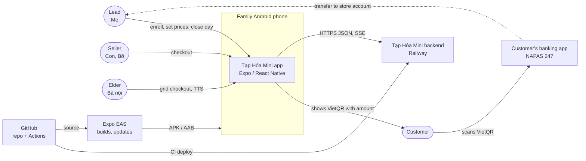

Payment confirmation in phase 1 is manual (the seller taps "Đã nhận"). Automatic bank
notification (S9) is phase 2 and adds a webhook provider to this diagram (§12).

## 3. Containers

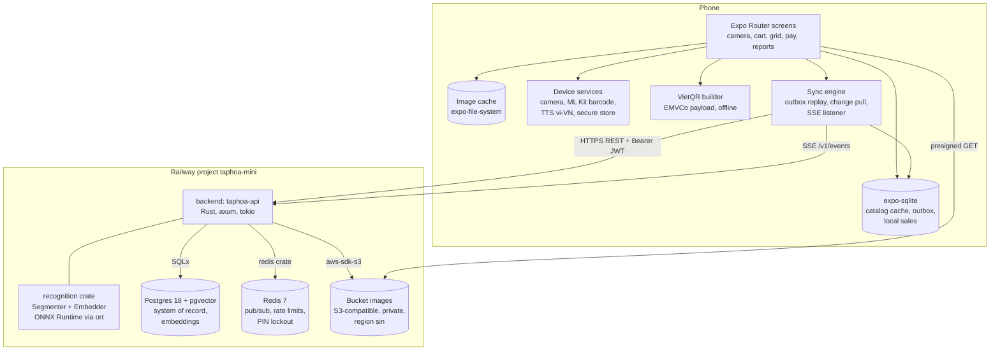

| Container         | Technology                                              | Responsibility                                                                      | State      |
| ----------------- | ------------------------------------------------------- | ----------------------------------------------------------------------------------- | ---------- |
| Mobile app        | Expo SDK 58, React Native 0.88, Expo Router, TypeScript | All UI; cart; VietQR; TTS; barcode; offline store of catalog and pending writes     | Skeleton   |
| Local DB          | `expo-sqlite`                                           | Catalog replica, outbox, local sales/expenses, sync cursor                          | Proposed   |
| API               | Rust stable, axum 0.8, tokio, tower-http, tracing       | Auth, REST, SSE, validation, store scoping, reports                                 | Skeleton   |
| Recognition crate | `ort` (ONNX Runtime, dynamic load), `image`             | `Segmenter` (SAM phase 1, YOLO phase 2), `Embedder` (DINOv2-class), crop filter/NMS | SAM done   |
| Postgres          | `pgvector/pgvector:0.8.7-pg18-trixie`, SQLx migrations  | System of record; embeddings and nearest-neighbor search; change log; outbox        | Running    |
| Redis             | Redis 7                                                 | Event fan-out (pub/sub), rate limits, PIN lockout counters                          | Running    |
| Object storage    | Railway Bucket (prod), RustFS (local/CI)                | Photo bytes: enrollment, checkout, crops, receipts                                  | Spec'd     |
| EAS               | EAS Build, EAS Workflows, Maestro                       | Native builds and mobile e2e                                                        | Configured |
| GitHub Actions    | `ci.yml`, `deploy.yml`                                  | Lint, test, container build, gated Railway deploy                                   | Running    |

Redis is never a source of truth. Losing it drops live events (the phone catches up
by pulling) and resets rate-limit counters.

## 4. Deployment

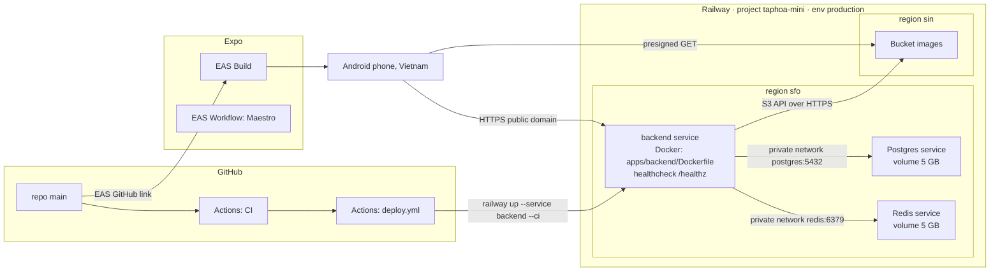

- Infrastructure is code in [`.railway/railway.ts`](../.railway/railway.ts); change it with
  `railway config plan` / `apply`. See [deploy.md](deploy.md).
- The backend image bundles ONNX Runtime and model weights (SAM encoder/decoder, and the
  embedding model once added). `SKIP_MODELS=1` builds a model-free image whose
  recognition routes return 503.
- **Region** (proposed follow-up): services run in `sfo` while users and the bucket are in
  Asia. Each scan pays a trans-Pacific round trip (~180 ms each way for a ~300 KB upload
  plus the response). Move backend, Postgres and Redis to an Asian region before the
  pilot; measure first against the 3 s budget.
- **Scaling**: one backend replica. Inference runs on CPU (Railway has no GPU) behind one
  in-process semaphore. Horizontal scaling later is safe because the API is stateless:
  SSE fan-out goes through Redis and all writes go to Postgres.

Local development uses the same graph in Docker Compose: `postgres`, `redis`, `backend`,
`storage` (RustFS, once object storage lands) and the optional `mobile` profile.

## 5. Backend design

### 5.1 Module layout (proposed)

The Cargo workspace keeps two crates today. Product modules go into the `api` crate as
folders; recognition stays a pure library with no HTTP or SQL.

```text
apps/backend/crates/
├── api/src/
│   ├── main.rs            config, tracing, startup, graceful shutdown
│   ├── lib.rs             AppState, router assembly, middleware
│   ├── error.rs           ApiError { status, code, message } -> JSON
│   ├── auth/              JWT, sessions, invites, recovery, PIN, extractor `Actor`
│   ├── store/             store settings, members
│   ├── images/            ObjectStore trait, S3 + in-memory adapters, presign
│   ├── catalog/           products, units, images, price history, categories
│   ├── recognition/       scan handler: store photo, segment, embed, search, persist
│   ├── sales/             create/void, manual-line review queue
│   ├── expenses/          expenses, purchase lines, margin alerts
│   ├── reports/           today, summary, top products, recognition, exports, day close
│   ├── sync/              change log feed, SSE endpoint
│   └── events/            transactional outbox, relay to Redis, SSE fan-out
└── recognition/src/
    ├── lib.rs             Segment, Segmenter, filter_and_nms, bbox_iou
    ├── sam.rs             SamSegmenter (ONNX encoder/decoder)         implemented
    ├── yolo.rs            YoloSegmenter                               stub, phase 2
    ├── embed.rs           Embedder trait, DinoEmbedder (ONNX)         proposed
    └── crop.rs            crop + resize + normalize helpers           proposed
```

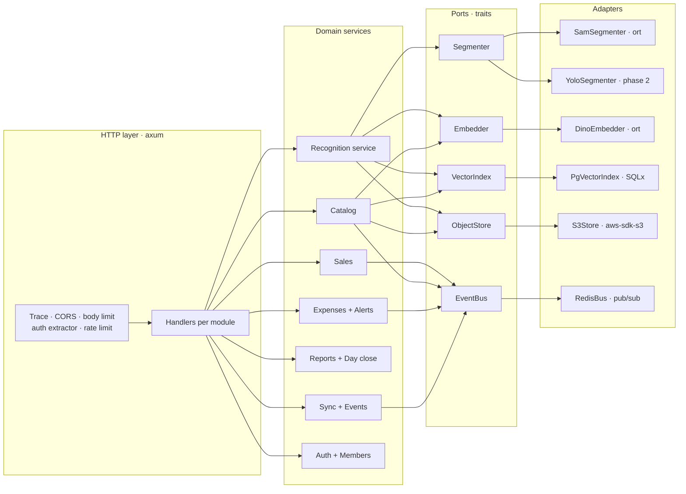

Every port has an in-memory fake for unit tests, as `MockSegmenter` does today.

### 5.2 Cross-cutting rules

- **Store scoping.** The `Actor` extractor decodes the JWT and yields
  `{member_id, store_id, role, can_enroll, session_id}`. Every query takes `store_id`
  from `Actor`, never from the request. Every table with store data has `store_id`, and
  every index used by handlers starts with it.
- **Authorization** is a function per action (`can(actor, Action)`), tested as a table.
  See the matrix in §8.
- **Idempotency.** Client-created records use the client UUIDv7 as primary key. The
  handler stores a SHA-256 of the canonical request body (`request_hash`). Same id and
  same hash returns 200 with the stored record; same id and different hash returns 409.
- **Transactions.** A write, its `change_log` rows and its `outbox_events` rows commit in
  one transaction. A relay task publishes committed outbox rows to Redis
  (see [data-model.md §5](data-model.md#5-events)).
- **Money** is `BIGINT` VND. Totals are recomputed on the server; the server never
  changes a price the seller saw.
- **Time.** Store `TIMESTAMPTZ`. `business_date` is derived once on write with
  `Asia/Ho_Chi_Minh` and stored, so reports never re-derive it.
- **Errors** map to `{error, code}` with stable `code` values; the phone localizes them.
- **Observability.** `tracing` spans per request with `store_id`, `member_id`,
  `request_id`; JSON logs on Railway (`LOG_FORMAT=json`). Scan timings (`segment`,
  `embed`, `search`) are logged and stored on the scan row for the cost/latency metric
  (PRD §6 Cost).
- **Limits.** 10 MiB body limit (implemented). Rate limits in Redis: store creation,
  join, recovery, PIN per IP/member; scans per store.

### 5.3 Recognition pipeline (phase 1)

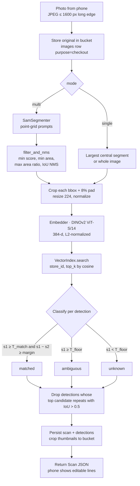

| Parameter                | Start value                   | Notes                                                                  |
| ------------------------ | ----------------------------- | ---------------------------------------------------------------------- |
| Embedding model          | DINOv2 ViT-S/14 (ONNX), 384-d | Proposed. Compare with CLIP ViT-B/32 on the A1 test set before fixing. |
| `T_match`                | 0.80                          | Cosine. Tune on A1 (≥ 90% top-1).                                      |
| `margin`                 | 0.05                          | Guards look-alike variants (Lavie 350 vs 500 ml).                      |
| `T_floor`                | 0.60                          | Below: "Không tìm thấy".                                               |
| Duplicate threshold (C2) | 0.88                          | Enrollment "Same as X?" prompt.                                        |
| `top_k`                  | 4                             | Top match + 3 alternatives (S1).                                       |

- **Vector search.** `product_embeddings` holds 1–5 vectors per product with an HNSW
  index (`vector_cosine_ops`). Per-store catalogs are small (hundreds to low thousands),
  so the query filters `store_id` first; pgvector 0.8 iterative scans keep filtered HNSW
  results complete. Search returns the best similarity per product.
- **Latency budget (≤ 3 s).** Upload 0.3–0.6 s, SAM encoder on CPU is the main cost,
  embedding ~20–40 ms per crop, search < 20 ms. SAM ViT-B missed the budget (about 20 s on
  4 cores), so the deployed segmenter is MobileSAM behind the same `Segmenter` trait; the
  embedder runs at 112 px input. Measurements and the 4 vCPU requirement are in
  [recognition-latency](specs/recognition-latency.md).
- **Concurrency.** One inference slot per instance (implemented). A second request gets
  `503 segmenter busy` with `Retry-After: 1`; the phone retries once and otherwise offers
  grid mode.
- **Training data.** `detections` keep bbox, crop image and the embedding. The confirmed
  sale line points back with `detection_id` and records `suggested_product_id`. This
  produces labeled crops and the confirmed-vs-corrected metric.

### 5.4 Phase 2 changes

- `YoloSegmenter` implements `Segmenter` with a model fine-tuned on phase 1 labels. It
  returns class ids that map to products trained so far; embedding match still runs for
  products added after the last training run.
- Export job: query confirmed detections and enrollment images into a YOLO dataset
  (images + labels) in the bucket. Training runs off-platform (GPU), and the resulting ONNX
  weights ship in the image like SAM weights.
- S9 automatic transfer confirmation: a webhook endpoint from a bank-notification
  provider matches the memo `sales_memo_prefix + sale.code` and amount, then emits
  `sale.payment_confirmed`.

## 6. Mobile design

### 6.1 Structure (proposed)

```text
apps/mobile/src/
├── app/                        Expo Router
│   ├── _layout.tsx             providers: db, auth, sync, i18n, font scale
│   ├── (onboarding)/           create store, bank account + test QR, join by QR
│   ├── (tabs)/sell/            camera (default), grid, cart, pay
│   ├── (tabs)/catalog/         price list, product detail, enroll
│   ├── (tabs)/today/           today report, expenses, day close, review queue, alerts
│   └── (tabs)/settings/        members, invite QR, PIN, elder mode, language
├── db/                         expo-sqlite schema, migrations, queries
├── sync/                       outbox worker, change puller, SSE client
├── api/                        typed client generated from docs/api/openapi.yaml
├── domain/                     cart math, VietQR payload + CRC, money format
└── lib/                        TTS, barcode, image downscale, secure token store
```

- **Typed client.** Generate TypeScript types from `docs/api/openapi.yaml`
  (e.g. `openapi-typescript`) so the contract is the source of truth for both sides.
- **Source of truth on the phone.** The phone reads catalog data only from SQLite. The
  network fills SQLite; screens never wait for the network except for scans.
- **Elder mode.** Grid-only sell tab, larger type scale, TTS on, no camera button.

### 6.2 Offline and sync model

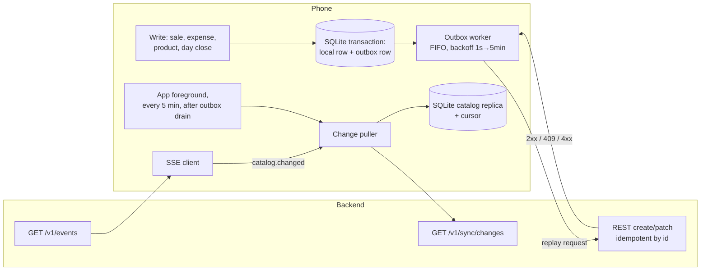

| Data                                 | Owner        | Direction     | Conflict rule                                                                                                                   |
| ------------------------------------ | ------------ | ------------- | ------------------------------------------------------------------------------------------------------------------------------- |
| Store, members, categories, products | Server       | Pull          | Server wins. Lead edits made offline replay as PATCH; last write wins by server receive time; every price change is in history. |
| Sales                                | Phone        | Push (outbox) | Append-only; idempotent by id. Void is a separate idempotent action.                                                            |
| Expenses, purchases                  | Phone        | Push (outbox) | Idempotent by id; edits are PATCH, last write wins.                                                                             |
| Day close                            | Phone (Lead) | Push (PUT)    | Last write wins per business date; server recomputes expected cash.                                                             |
| Images                               | Phone        | Upload first  | Outbox entry waits until its image upload returns an `image_id`.                                                                |

Outbox rules:

- Entries replay in order. A network error or 5xx retries with backoff. A 409
  `id_conflict` or a 4xx validation error moves the entry to `failed` and shows a badge
  for the Lead; it never blocks later entries.
- Sales made offline use prices from the local replica. If the price changed meanwhile,
  the server flags the line (`price_mismatch`) instead of rejecting the sale.
- VietQR works offline: the payload is built on the phone from the cached bank account.

### 6.3 VietQR

The phone builds an EMVCo merchant-presented payload following the NAPAS VietQR
specification: payload format, point of initiation `12` (dynamic), merchant account info
with NAPAS GUID `A000000727`, bank BIN and account number, service code `QRIBFTTA`,
currency `704`, amount, country `VN`, additional data memo, CRC-16/CCITT-FALSE. The memo
is `{sales_memo_prefix} {sale.code}` (ASCII, ≤ 25 chars) so a later bank-notification
integration can match transfers. Verify the field layout against the current NAPAS
specification before implementation; unit-test the builder against known-good payloads
from a bank app.

## 7. Data

The full schema, ER diagram, local SQLite schema, event catalog and state machines are
in [data-model.md](data-model.md). Summary:

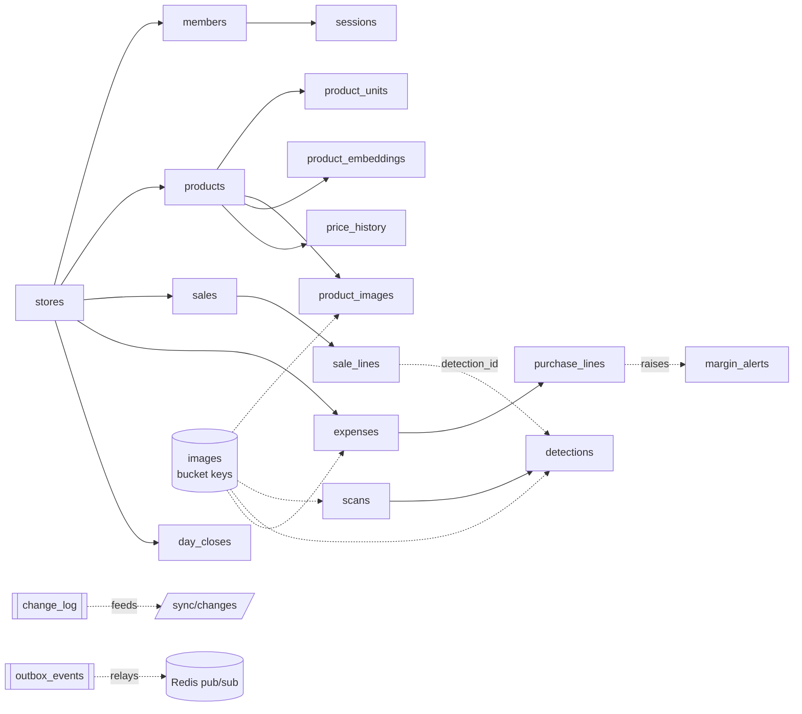

## 8. Security

| Topic         | Design                                                                                                                                                       |
| ------------- | ------------------------------------------------------------------------------------------------------------------------------------------------------------ |
| Identity      | No phone number or email needed. A member is a display name inside a store. Devices hold a session created by store creation, invite join or recovery.       |
| Tokens        | Access JWT HS256, 15 min (`JWT_SECRET` from Railway). Refresh token opaque, 90 days, rotating, SHA-256 hashed in `sessions`; reuse revokes the session.      |
| Token storage | `expo-secure-store` on the phone.                                                                                                                            |
| Invites       | 128-bit random token, hashed, single use, 10 min default, shown as QR on the Lead's phone.                                                                   |
| Recovery      | One recovery code per store, Argon2id-hashed, shown once at creation, rotated on use.                                                                        |
| PIN           | Optional 4–6 digits, Argon2id; 5 failures lock the member 5 min (Redis).                                                                                     |
| Images        | Private bucket; only presigned GET URLs (15 min). Clients never hold bucket credentials.                                                                     |
| Transport     | HTTPS only on Railway domains. CORS stays permissive only while there is no web client.                                                                      |
| Secrets       | Railway variables (`JWT_SECRET`, `AWS_*`) kept with `preserve()`; never in git.                                                                              |
| Personal data | Member display names and device names only. Photos are of products. Store deletion removes all rows and objects (Decree 13/2023 request handling, proposed). |

Permission matrix:

| Action                                         | Lead | Seller | Seller + `can_enroll` |
| ---------------------------------------------- | :--: | :----: | :-------------------: |
| Scan, sell, grid, manual-price line            |  ✓   |   ✓    |           ✓           |
| Void own sale same day                         |  ✓   |   ✓    |           ✓           |
| Void any sale                                  |  ✓   |        |                       |
| Enroll product, add reference photo            |  ✓   |        |           ✓           |
| Change price / cost, archive product           |  ✓   |        |                       |
| Add expense                                    |  ✓   |   ✓    |           ✓           |
| Edit or delete any expense                     |  ✓   |        |                       |
| Review queue, alerts, recognition report       |  ✓   |        |                       |
| Day close, exports                             |  ✓   |        |                       |
| Store settings, bank account, members, invites |  ✓   |        |                       |

## 9. Interaction sequences

Participants: **Phone** (app + SQLite), **API** (taphoa-api), **Rec** (recognition crate),
**PG** (Postgres), **S3** (bucket), **Redis**.

### 9.1 First setup (F1)

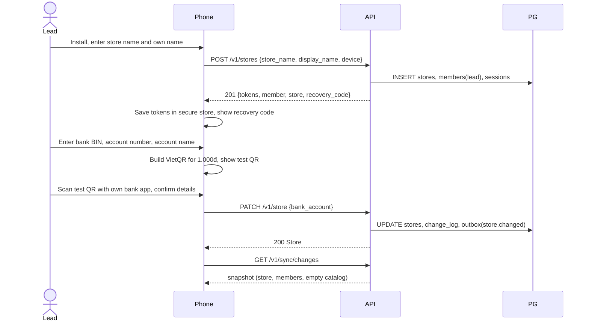

### 9.2 Family member joins (U1)

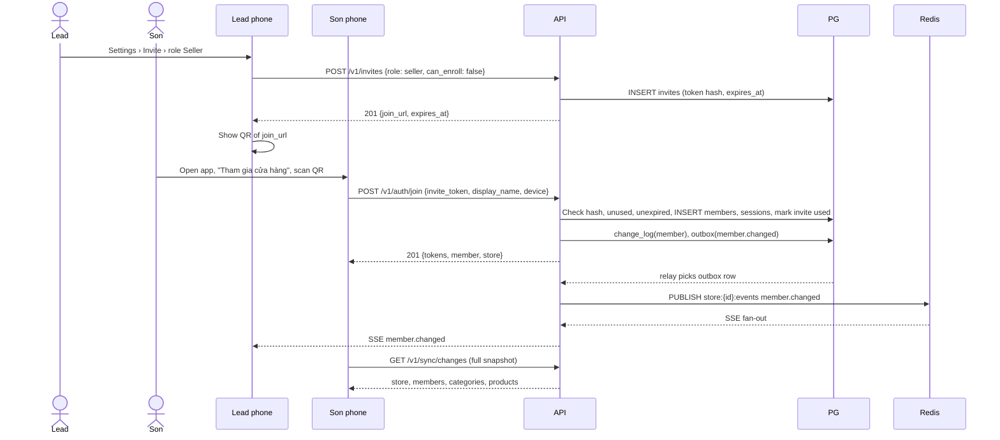

### 9.3 Product enrollment with duplicate check (C1, C2)

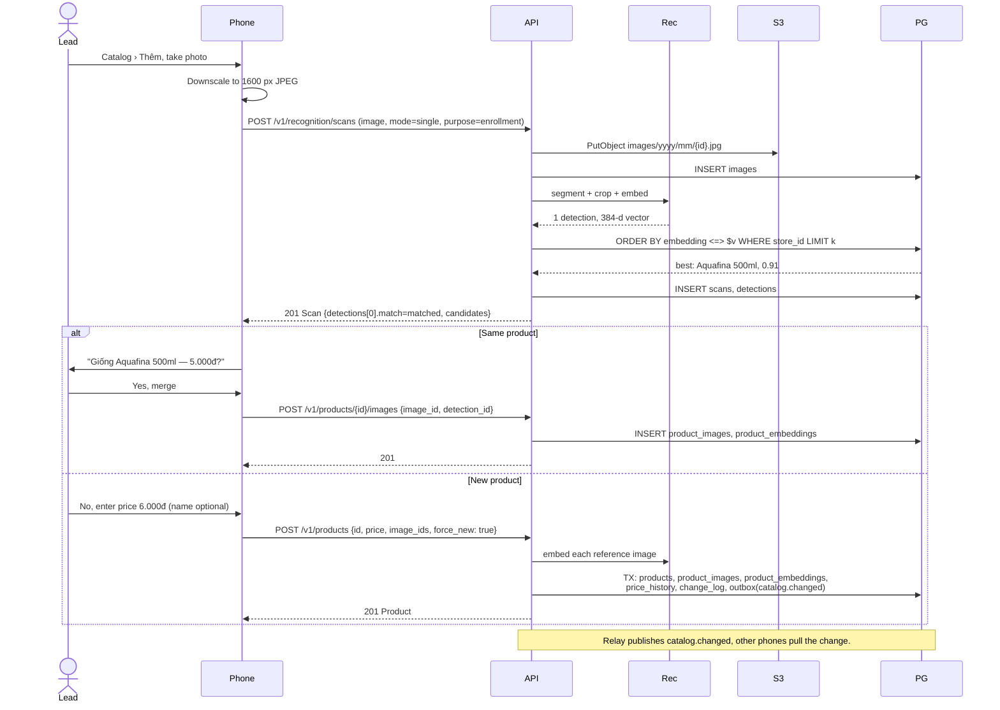

### 9.4 Checkout with multi-item photo and VietQR (F2, S5, S6, S8)

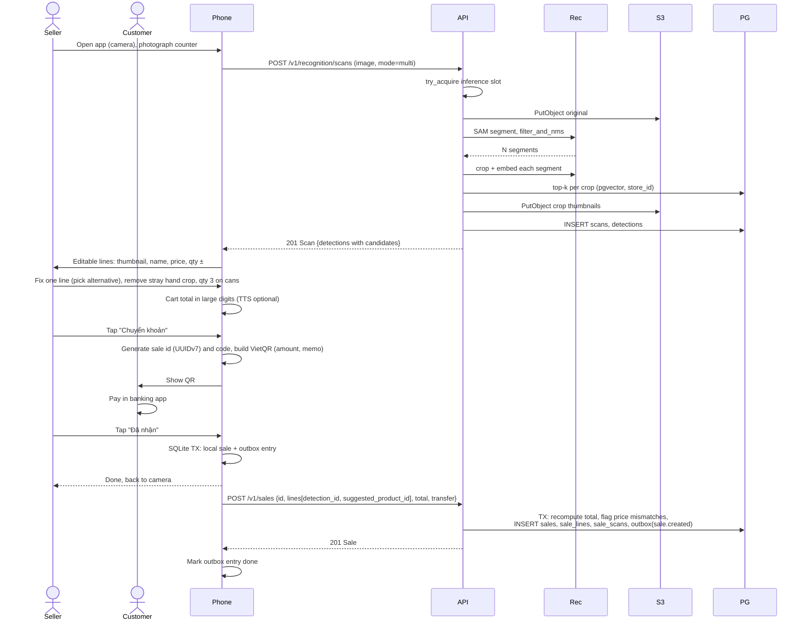

Single-item camera (S1), barcode (S2) and grid (S3) skip the multi-photo call: S1 uses
`mode=single`; barcode and grid resolve against the local catalog with no network.

### 9.5 Unknown item and Lead review (F3, S4)

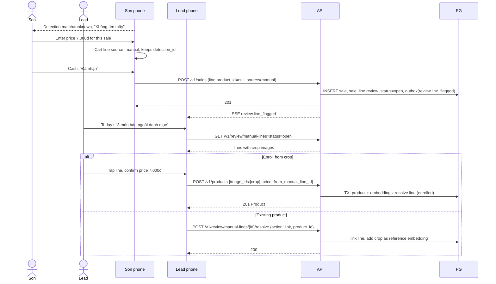

### 9.6 Purchase raises cost, price change propagates (F4, E2, E3, G4)

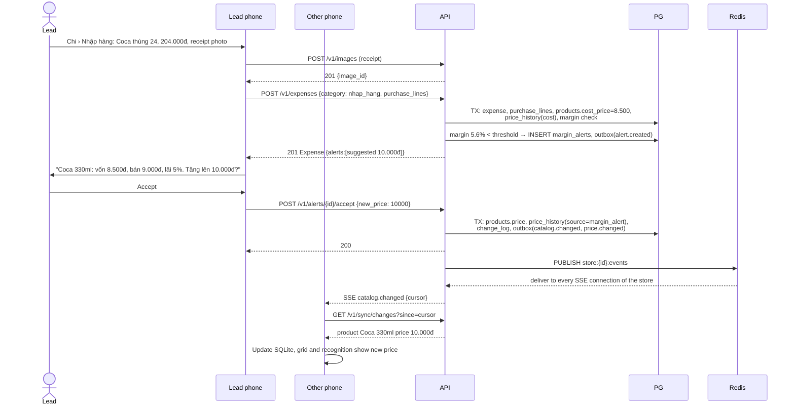

An offline phone gets the change on its next pull. A sale made offline at the old price
keeps 9.000đ and its line is flagged `price_mismatch`.

### 9.7 End of day close (F5, R1, R2)

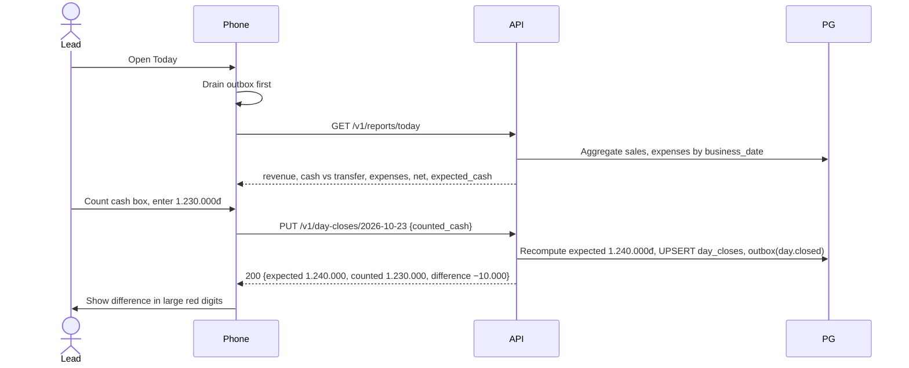

### 9.8 Offline sale and later sync

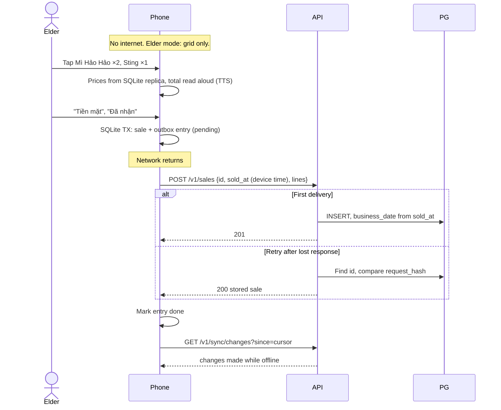

### 9.9 Token refresh and member switch on a shared phone (U3, U4)

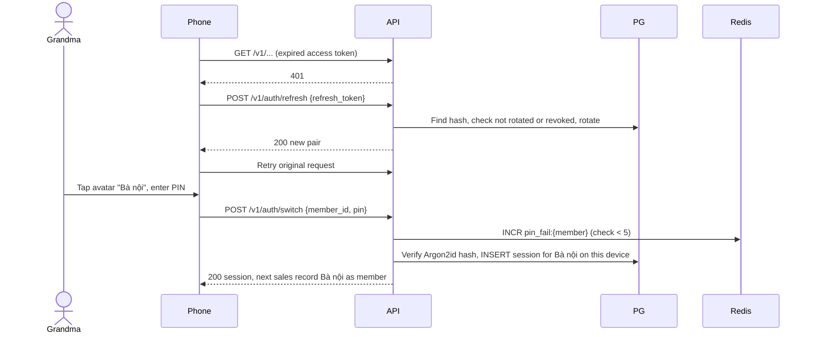

## 10. Configuration

| Variable                                                                    | Used by | State       | Meaning                                          |
| --------------------------------------------------------------------------- | ------- | ----------- | ------------------------------------------------ |
| `PORT`, `RUST_LOG`, `LOG_FORMAT`                                            | backend | Implemented | Listen port, log filter, `json` on Railway       |
| `DATABASE_URL`, `REDIS_URL`                                                 | backend | Implemented | Railway references                               |
| `SAM_ENCODER_PATH`, `SAM_DECODER_PATH`                                      | backend | Implemented | SAM ONNX weights                                 |
| `AWS_*`, `S3_FORCE_PATH_STYLE`, `S3_CREATE_BUCKET`, `IMAGE_URL_TTL_SECONDS` | backend | Spec'd      | Object storage ([spec](specs/object-storage.md)) |
| `EMBEDDER_MODEL_PATH`                                                       | backend | Proposed    | DINOv2 ONNX weights                              |
| `MATCH_THRESHOLD`, `MATCH_MARGIN`, `MATCH_FLOOR`, `DUPLICATE_THRESHOLD`     | backend | Proposed    | Recognition tuning (§5.3)                        |
| `JWT_SECRET`                                                                | backend | Implemented | ≥ 32 random bytes                                |
| `EXPO_PUBLIC_API_URL`                                                       | mobile  | Implemented | Backend base URL                                 |

## 11. Quality attributes

| Requirement (PRD §6)         | How the architecture meets it                                                     | How we measure                             |
| ---------------------------- | --------------------------------------------------------------------------------- | ------------------------------------------ |
| Photo to editable cart ≤ 3 s | Phone downscale; single round trip; ONNX on CPU; swappable segmenter; region move | `scans.timings`, `/v1/reports/recognition` |
| Offline grid, manual, VietQR | SQLite replica, outbox, local VietQR                                              | Maestro flow in airplane mode              |
| Never charge unconfirmed     | API returns candidates only; sale lines come from the phone                       | Code review rule; API has no "auto-sale"   |
| No data loss after last sync | Server is system of record; Postgres volume + Railway backups; idempotent replay  | Restore drill onto a new phone             |
| Accuracy metric              | `detection_id` + `suggested_product_id` on lines                                  | Confirmed-vs-corrected rate                |
| Cost per scan                | Timings per stage; one CPU instance                                               | Railway usage ÷ scans per day              |

## 12. Open decisions

| #   | Decision                                                | Default in this document                  | Settle by                   |
| --- | ------------------------------------------------------- | ----------------------------------------- | --------------------------- |
| D1  | Embedding model                                         | DINOv2 ViT-S/14, 384-d                    | A1 benchmark on 50 products |
| D2  | SAM variant on CPU within 3 s                           | Current SAM ONNX; smaller variant if slow | Latency test on Railway     |
| D3  | Railway region for services                             | Move to an Asian region                   | Before pilot                |
| D4  | Auth model: device sessions + invite QR + recovery code | As in §8                                  | ADR 0003                    |
| D5  | Sync: REST outbox + change feed + SSE hints             | As in §6.2                                | ADR 0004                    |
| D6  | Helpers enroll or only flag (PRD Q5)                    | Per-member `can_enroll` flag, default off | Family trial                |
| D7  | Weighted goods (PRD Q3)                                 | Not modeled; integer quantities only      | Product decision            |
| D8  | Bank notification provider (S9)                         | Out of phase 1                            | PRD Q1                      |
