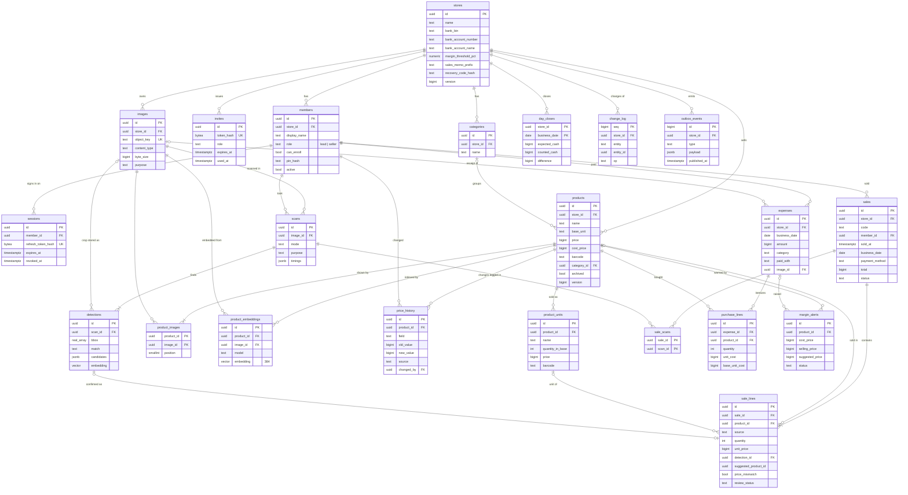
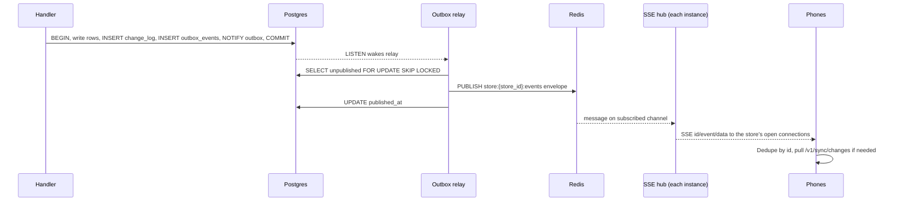
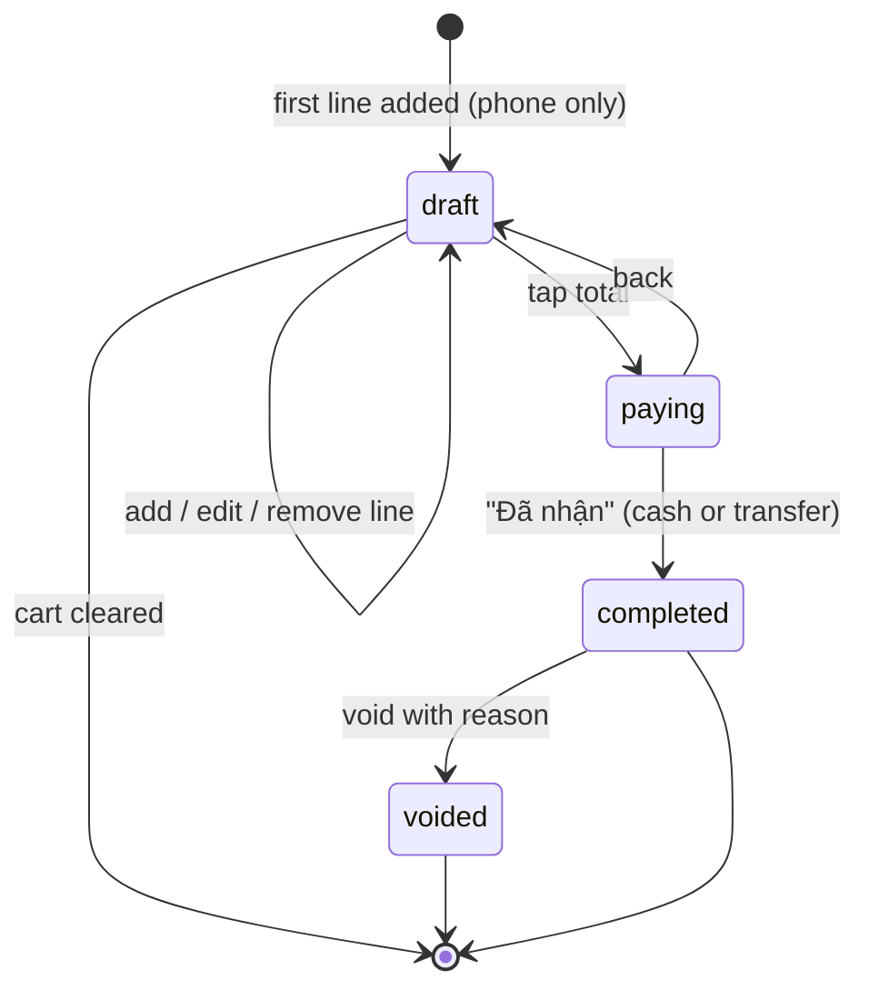
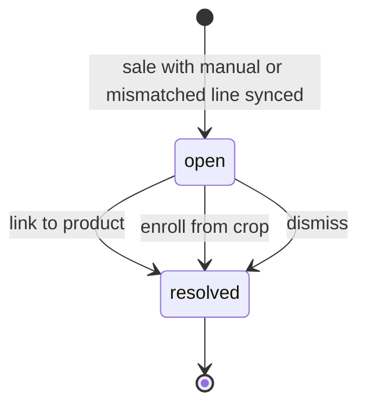
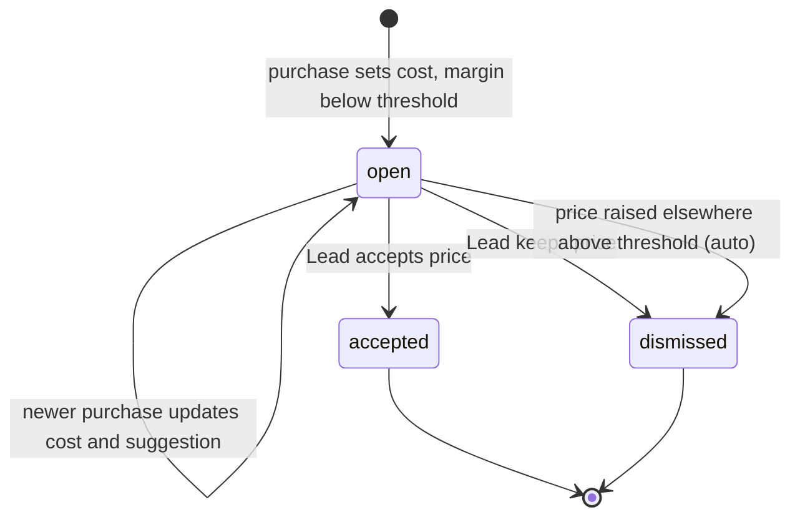
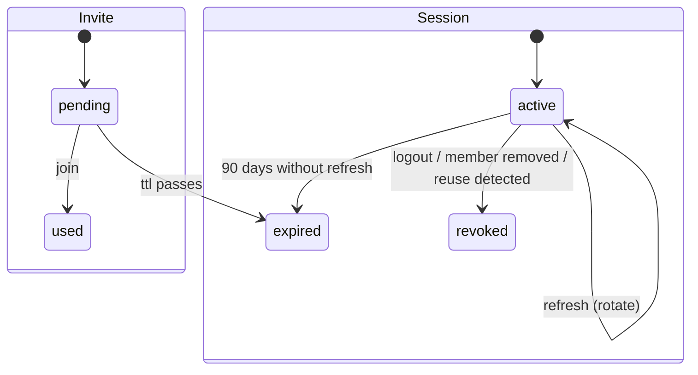
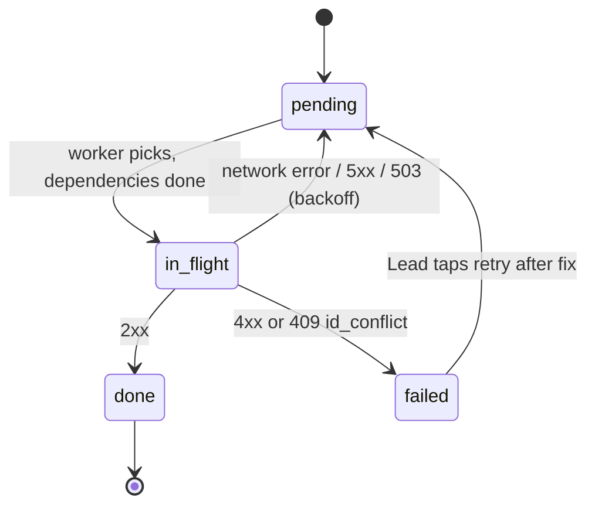

# Tạp Hóa Mini — Data model, events and contracts

Status: Proposed · Date: 2026-10-23 · Related: [architecture](architecture.md),
[OpenAPI](api/openapi.yaml), [AsyncAPI](api/asyncapi.yaml), [PRD](PRD.md)

This document is the contract for everything stored or emitted: the Postgres schema
(server system of record), the SQLite schema on the phone, the object storage layout,
domain events, and the lifecycle of each stateful record.

Implemented today: migration `0001_init.sql` (`vector` extension, `stores(id, name, created_at)`).
The `images` table is accepted in the [object storage spec](specs/object-storage.md).
Everything else is a proposal that later migrations implement.

## 1. Conventions

| Topic       | Rule                                                                                                                |
| ----------- | ------------------------------------------------------------------------------------------------------------------- |
| Keys        | `UUID` primary keys. Server-created rows use `gen_random_uuid()`; phone-created rows use client UUIDv7.             |
| Tenancy     | Every store-owned table has `store_id UUID NOT NULL REFERENCES stores`. Every handler index starts with `store_id`. |
| Money       | `BIGINT` VND, `CHECK (x >= 0)` unless a difference.                                                                 |
| Time        | `TIMESTAMPTZ`. `business_date DATE` is derived on write in `Asia/Ho_Chi_Minh` and stored.                           |
| Soft delete | `archived` / `deleted_at` / `active` on records other records reference. Sales are never deleted.                   |
| Versioning  | Pulled entities carry `version BIGINT`, incremented on every update; the change log carries the order.              |
| Idempotency | Phone-created rows store `request_hash BYTEA` (SHA-256 of canonical JSON body).                                     |
| Enums       | Postgres `TEXT` + `CHECK` constraints (easier to extend in migrations than `CREATE TYPE`).                          |
| Names       | `snake_case`, plural tables, `<table>_id` foreign keys.                                                             |

## 2. Entity-relationship diagram



## 3. Postgres schema

DDL below is the target. Migrations implement it in steps (auth, images, catalog,
recognition, sales, expenses, reports, sync). Check current Postgres 18 and pgvector 0.8
docs before writing each migration.

### 3.1 Tenancy and identity

```sql
-- 0001 created stores(id, name, created_at); this extends it.
ALTER TABLE stores
    ADD COLUMN bank_bin             TEXT CHECK (bank_bin ~ '^[0-9]{6}$'),
    ADD COLUMN bank_short_name      TEXT,
    ADD COLUMN bank_account_number  TEXT CHECK (bank_account_number ~ '^[0-9A-Za-z]{4,19}$'),
    ADD COLUMN bank_account_name    TEXT CHECK (char_length(bank_account_name) <= 50),
    ADD COLUMN margin_threshold_pct NUMERIC(5,2) NOT NULL DEFAULT 0
                                    CHECK (margin_threshold_pct BETWEEN 0 AND 100),
    ADD COLUMN sales_memo_prefix    TEXT NOT NULL DEFAULT 'TH' CHECK (char_length(sales_memo_prefix) <= 8),
    ADD COLUMN recovery_code_hash   TEXT NOT NULL,          -- Argon2id PHC string
    ADD COLUMN version              BIGINT NOT NULL DEFAULT 1,
    ADD COLUMN updated_at           TIMESTAMPTZ NOT NULL DEFAULT now(),
    ADD CONSTRAINT bank_all_or_none CHECK (
        (bank_bin IS NULL) = (bank_account_number IS NULL)
        AND (bank_bin IS NULL) = (bank_account_name IS NULL));

CREATE TABLE members (
    id           UUID PRIMARY KEY DEFAULT gen_random_uuid(),
    store_id     UUID NOT NULL REFERENCES stores ON DELETE CASCADE,
    display_name TEXT NOT NULL CHECK (char_length(display_name) BETWEEN 1 AND 40),
    role         TEXT NOT NULL CHECK (role IN ('lead', 'seller')),
    can_enroll   BOOLEAN NOT NULL DEFAULT false,
    pin_hash     TEXT,                                      -- Argon2id, null = no PIN
    active       BOOLEAN NOT NULL DEFAULT true,
    version      BIGINT NOT NULL DEFAULT 1,
    created_at   TIMESTAMPTZ NOT NULL DEFAULT now(),
    updated_at   TIMESTAMPTZ NOT NULL DEFAULT now()
);
CREATE INDEX members_store ON members (store_id) WHERE active;
-- "at least one active lead" is enforced in the handler inside the transaction
-- (SELECT ... FOR UPDATE on the store's lead rows).

CREATE TABLE sessions (
    id                 UUID PRIMARY KEY DEFAULT gen_random_uuid(),
    store_id           UUID NOT NULL REFERENCES stores ON DELETE CASCADE,
    member_id          UUID NOT NULL REFERENCES members ON DELETE CASCADE,
    device_name        TEXT NOT NULL,
    platform           TEXT NOT NULL CHECK (platform IN ('android', 'ios', 'web')),
    app_version        TEXT,
    refresh_token_hash BYTEA NOT NULL UNIQUE,               -- SHA-256 of current token
    previous_token_hash BYTEA,                              -- reuse detection
    expires_at         TIMESTAMPTZ NOT NULL,
    revoked_at         TIMESTAMPTZ,
    last_seen_at       TIMESTAMPTZ NOT NULL DEFAULT now(),
    created_at         TIMESTAMPTZ NOT NULL DEFAULT now()
);
CREATE INDEX sessions_member ON sessions (member_id) WHERE revoked_at IS NULL;
CREATE INDEX sessions_previous ON sessions (previous_token_hash) WHERE previous_token_hash IS NOT NULL;

CREATE TABLE invites (
    id          UUID PRIMARY KEY DEFAULT gen_random_uuid(),
    store_id    UUID NOT NULL REFERENCES stores ON DELETE CASCADE,
    token_hash  BYTEA NOT NULL UNIQUE,
    role        TEXT NOT NULL CHECK (role IN ('lead', 'seller')),
    can_enroll  BOOLEAN NOT NULL DEFAULT false,
    created_by  UUID NOT NULL REFERENCES members,
    expires_at  TIMESTAMPTZ NOT NULL,
    used_at     TIMESTAMPTZ,
    used_by     UUID REFERENCES members,
    created_at  TIMESTAMPTZ NOT NULL DEFAULT now()
);
```

### 3.2 Images

```sql
-- Accepted in specs/object-storage.md; store_id becomes NOT NULL once auth lands.
CREATE TABLE images (
    id           UUID PRIMARY KEY DEFAULT gen_random_uuid(),
    store_id     UUID REFERENCES stores ON DELETE CASCADE,
    object_key   TEXT NOT NULL UNIQUE,                      -- images/{yyyy}/{mm}/{id}.{ext}
    content_type TEXT NOT NULL CHECK (content_type IN ('image/jpeg', 'image/png', 'image/webp')),
    byte_size    BIGINT NOT NULL CHECK (byte_size > 0 AND byte_size <= 10485760),
    purpose      TEXT NOT NULL DEFAULT 'other'
                 CHECK (purpose IN ('enrollment', 'checkout', 'crop', 'expense_receipt', 'other')),
    width        INT,
    height       INT,
    uploaded_by  UUID REFERENCES members,
    created_at   TIMESTAMPTZ NOT NULL DEFAULT now()
);
CREATE INDEX images_store_created ON images (store_id, created_at DESC);
```

### 3.3 Catalog

```sql
CREATE TABLE categories (
    id         UUID PRIMARY KEY,
    store_id   UUID NOT NULL REFERENCES stores ON DELETE CASCADE,
    name       TEXT NOT NULL CHECK (char_length(name) BETWEEN 1 AND 40),
    version    BIGINT NOT NULL DEFAULT 1,
    created_at TIMESTAMPTZ NOT NULL DEFAULT now()
);
CREATE UNIQUE INDEX categories_store_name ON categories (store_id, lower(name));

CREATE TABLE products (
    id           UUID PRIMARY KEY,                          -- client UUIDv7
    store_id     UUID NOT NULL REFERENCES stores ON DELETE CASCADE,
    name         TEXT CHECK (char_length(name) <= 120),
    base_unit    TEXT NOT NULL DEFAULT 'cái',
    price        BIGINT NOT NULL CHECK (price >= 0),
    cost_price   BIGINT CHECK (cost_price >= 0),
    barcode      TEXT,
    category_id  UUID REFERENCES categories,
    archived     BOOLEAN NOT NULL DEFAULT false,
    version      BIGINT NOT NULL DEFAULT 1,
    request_hash BYTEA NOT NULL,
    created_by   UUID NOT NULL REFERENCES members,
    created_at   TIMESTAMPTZ NOT NULL DEFAULT now(),
    updated_at   TIMESTAMPTZ NOT NULL DEFAULT now()
);
CREATE INDEX products_store ON products (store_id) WHERE NOT archived;
CREATE UNIQUE INDEX products_store_barcode ON products (store_id, barcode) WHERE barcode IS NOT NULL;
-- Accent-insensitive search for "hao hao" -> "Hảo Hảo". Needs extensions unaccent and pg_trgm,
-- plus an IMMUTABLE SQL wrapper immutable_unaccent(text) around unaccent('unaccent', $1),
-- because unaccent() itself is only STABLE and cannot back an index.
CREATE INDEX products_name_trgm ON products USING gin (immutable_unaccent(lower(name)) gin_trgm_ops);

CREATE TABLE product_units (
    id               UUID PRIMARY KEY,
    store_id         UUID NOT NULL REFERENCES stores ON DELETE CASCADE,
    product_id       UUID NOT NULL REFERENCES products ON DELETE CASCADE,
    name             TEXT NOT NULL,                         -- lốc, thùng
    quantity_in_base INT NOT NULL CHECK (quantity_in_base >= 2),
    price            BIGINT NOT NULL CHECK (price >= 0),
    barcode          TEXT,
    UNIQUE (product_id, name)
);
CREATE UNIQUE INDEX product_units_store_barcode ON product_units (store_id, barcode) WHERE barcode IS NOT NULL;

CREATE TABLE product_images (
    product_id UUID NOT NULL REFERENCES products ON DELETE CASCADE,
    image_id   UUID NOT NULL REFERENCES images,
    position   SMALLINT NOT NULL CHECK (position BETWEEN 0 AND 4),
    created_at TIMESTAMPTZ NOT NULL DEFAULT now(),
    PRIMARY KEY (product_id, image_id),
    UNIQUE (product_id, position)
);

CREATE TABLE product_embeddings (
    id           UUID PRIMARY KEY DEFAULT gen_random_uuid(),
    store_id     UUID NOT NULL REFERENCES stores ON DELETE CASCADE,
    product_id   UUID NOT NULL REFERENCES products ON DELETE CASCADE,
    image_id     UUID NOT NULL REFERENCES images,
    detection_id UUID,                                      -- crop source, when from a scan
    model        TEXT NOT NULL,                             -- e.g. dinov2-vits14-onnx@1
    embedding    vector(384) NOT NULL,                      -- L2-normalized
    created_at   TIMESTAMPTZ NOT NULL DEFAULT now()
);
CREATE INDEX product_embeddings_hnsw ON product_embeddings
    USING hnsw (embedding vector_cosine_ops) WITH (m = 16, ef_construction = 64);
CREATE INDEX product_embeddings_store ON product_embeddings (store_id, model);

CREATE TABLE price_history (
    id         UUID PRIMARY KEY DEFAULT gen_random_uuid(),
    store_id   UUID NOT NULL REFERENCES stores ON DELETE CASCADE,
    product_id UUID NOT NULL REFERENCES products ON DELETE CASCADE,
    unit_id    UUID REFERENCES product_units ON DELETE SET NULL,
    field      TEXT NOT NULL CHECK (field IN ('price', 'cost_price', 'unit_price')),
    old_value  BIGINT,
    new_value  BIGINT NOT NULL,
    source     TEXT NOT NULL CHECK (source IN ('manual', 'margin_alert', 'purchase')),
    changed_by UUID NOT NULL REFERENCES members,
    changed_at TIMESTAMPTZ NOT NULL DEFAULT now()
);
CREATE INDEX price_history_product ON price_history (product_id, changed_at DESC);
```

Nearest-neighbor query (one row per product, best reference wins):

```sql
SET LOCAL hnsw.iterative_scan = relaxed_order;   -- keep filtered results complete
SELECT product_id, max(1 - (embedding <=> $1)) AS similarity
FROM (
    SELECT product_id, embedding
    FROM product_embeddings e
    JOIN products p ON p.id = e.product_id AND NOT p.archived
    WHERE e.store_id = $2 AND e.model = $3
    ORDER BY e.embedding <=> $1
    LIMIT 40
) nearest
GROUP BY product_id
ORDER BY similarity DESC
LIMIT $4;
```

Changing the embedding model writes new rows with the new `model` value (backfill job),
then switches the configured model; old rows are deleted after the switch.

### 3.4 Recognition data

```sql
CREATE TABLE scans (
    id              UUID PRIMARY KEY DEFAULT gen_random_uuid(),
    store_id        UUID NOT NULL REFERENCES stores ON DELETE CASCADE,
    image_id        UUID NOT NULL REFERENCES images,
    member_id       UUID NOT NULL REFERENCES members,
    mode            TEXT NOT NULL CHECK (mode IN ('single', 'multi')),
    purpose         TEXT NOT NULL CHECK (purpose IN ('checkout', 'enrollment')),
    segmenter       TEXT NOT NULL,                          -- mobilesam-onnx@1
    embedder        TEXT NOT NULL,
    catalog_version BIGINT NOT NULL,                        -- change_log seq at scan time
    timings         JSONB NOT NULL,                         -- {segment, embed, search, total} ms
    created_at      TIMESTAMPTZ NOT NULL DEFAULT now()
);
CREATE INDEX scans_store_created ON scans (store_id, created_at DESC);

CREATE TABLE detections (
    id            UUID PRIMARY KEY DEFAULT gen_random_uuid(),
    store_id      UUID NOT NULL REFERENCES stores ON DELETE CASCADE,
    scan_id       UUID NOT NULL REFERENCES scans ON DELETE CASCADE,
    position      SMALLINT NOT NULL,
    bbox          REAL[] NOT NULL CHECK (array_length(bbox, 1) = 4),
    score         REAL NOT NULL,
    area          INT NOT NULL,
    crop_image_id UUID REFERENCES images,
    embedding     vector(384),
    match         TEXT NOT NULL CHECK (match IN ('matched', 'ambiguous', 'unknown')),
    candidates    JSONB NOT NULL,                           -- [{product_id, similarity}] at scan time
    UNIQUE (scan_id, position)
);
```

### 3.5 Sales

```sql
CREATE TABLE sales (
    id             UUID PRIMARY KEY,                        -- client UUIDv7
    store_id       UUID NOT NULL REFERENCES stores ON DELETE CASCADE,
    code           TEXT NOT NULL,                           -- 6 chars Crockford base32 from id
    member_id      UUID NOT NULL REFERENCES members,
    session_id     UUID REFERENCES sessions ON DELETE SET NULL,
    sold_at        TIMESTAMPTZ NOT NULL,                    -- device time
    received_at    TIMESTAMPTZ NOT NULL DEFAULT now(),      -- server time
    business_date  DATE NOT NULL,
    payment_method TEXT NOT NULL CHECK (payment_method IN ('cash', 'transfer')),
    cash_received  BIGINT CHECK (cash_received >= 0),
    total          BIGINT NOT NULL CHECK (total >= 0),
    vietqr_memo    TEXT,
    status         TEXT NOT NULL DEFAULT 'completed' CHECK (status IN ('completed', 'voided')),
    void_reason    TEXT,
    voided_by      UUID REFERENCES members,
    voided_at      TIMESTAMPTZ,
    request_hash   BYTEA NOT NULL,
    CHECK (payment_method = 'cash' OR cash_received IS NULL),
    CHECK (cash_received IS NULL OR cash_received >= total),
    CHECK ((status = 'voided') = (voided_at IS NOT NULL)),
    UNIQUE (store_id, code)
);
CREATE INDEX sales_store_date ON sales (store_id, business_date, payment_method) WHERE status = 'completed';
CREATE INDEX sales_store_sold ON sales (store_id, sold_at DESC);

CREATE TABLE sale_lines (
    id                   UUID PRIMARY KEY,
    store_id             UUID NOT NULL REFERENCES stores ON DELETE CASCADE,
    sale_id              UUID NOT NULL REFERENCES sales ON DELETE CASCADE,
    position             SMALLINT NOT NULL,
    product_id           UUID REFERENCES products,
    unit_id              UUID REFERENCES product_units,
    source               TEXT NOT NULL CHECK (source IN ('camera', 'multi_photo', 'barcode', 'grid', 'manual')),
    quantity             INT NOT NULL CHECK (quantity BETWEEN 1 AND 999),
    unit_price           BIGINT NOT NULL CHECK (unit_price >= 0),
    line_total           BIGINT GENERATED ALWAYS AS (quantity * unit_price) STORED,
    quantity_in_base     INT NOT NULL DEFAULT 1,            -- snapshot of unit size for reports
    manual_label         TEXT,
    detection_id         UUID UNIQUE REFERENCES detections ON DELETE SET NULL,
    suggested_product_id UUID,
    price_mismatch       BOOLEAN NOT NULL DEFAULT false,
    review_status        TEXT CHECK (review_status IN ('open', 'resolved')),
    review_reason        TEXT CHECK (review_reason IN ('manual_price', 'price_mismatch')),
    review_action        TEXT CHECK (review_action IN ('link', 'enrolled', 'dismiss')),
    review_product_id    UUID REFERENCES products,
    reviewed_by          UUID REFERENCES members,
    reviewed_at          TIMESTAMPTZ,
    -- Only manual lines may lack a product; resolving a manual line sets review_product_id, not product_id.
    CHECK (source = 'manual' OR product_id IS NOT NULL),
    UNIQUE (sale_id, position)
);
CREATE INDEX sale_lines_review ON sale_lines (store_id, review_status) WHERE review_status = 'open';
CREATE INDEX sale_lines_product ON sale_lines (store_id, product_id);

CREATE TABLE sale_scans (
    sale_id UUID NOT NULL REFERENCES sales ON DELETE CASCADE,
    scan_id UUID NOT NULL REFERENCES scans ON DELETE CASCADE,
    PRIMARY KEY (sale_id, scan_id)
);
```

Rules enforced by the sales handler (not by constraints):

- `total = Σ line_total`, else 400 `total_mismatch`.
- `product_id IS NULL` only when `source = 'manual'`; such lines get `review_status='open'`,
  `review_reason='manual_price'`.
- `price_mismatch = unit_price ≠ catalog price at sold_at` (from `price_history`); such
  lines also open a review with `review_reason='price_mismatch'`.
- `business_date = (sold_at AT TIME ZONE 'Asia/Ho_Chi_Minh')::date`.

### 3.6 Expenses, purchases, alerts

```sql
CREATE TABLE expenses (
    id            UUID PRIMARY KEY,
    store_id      UUID NOT NULL REFERENCES stores ON DELETE CASCADE,
    member_id     UUID NOT NULL REFERENCES members,
    spent_at      TIMESTAMPTZ NOT NULL,
    business_date DATE NOT NULL,
    amount        BIGINT NOT NULL CHECK (amount > 0),
    category      TEXT NOT NULL CHECK (category IN ('nhap_hang', 'dien', 'nuoc', 'khac')),
    paid_with     TEXT NOT NULL CHECK (paid_with IN ('cash_box', 'other')),
    image_id      UUID REFERENCES images,
    note          TEXT CHECK (char_length(note) <= 500),
    deleted_at    TIMESTAMPTZ,
    request_hash  BYTEA NOT NULL,
    created_at    TIMESTAMPTZ NOT NULL DEFAULT now(),
    updated_at    TIMESTAMPTZ NOT NULL DEFAULT now()
);
CREATE INDEX expenses_store_date ON expenses (store_id, business_date) WHERE deleted_at IS NULL;

CREATE TABLE purchase_lines (
    id             UUID PRIMARY KEY DEFAULT gen_random_uuid(),
    store_id       UUID NOT NULL REFERENCES stores ON DELETE CASCADE,
    expense_id     UUID NOT NULL REFERENCES expenses ON DELETE CASCADE,
    product_id     UUID NOT NULL REFERENCES products,
    unit_id        UUID REFERENCES product_units,
    quantity       INT NOT NULL CHECK (quantity > 0),
    unit_cost      BIGINT NOT NULL CHECK (unit_cost >= 0),
    base_unit_cost BIGINT NOT NULL CHECK (base_unit_cost >= 0)  -- unit_cost / quantity_in_base, rounded up
);

CREATE TABLE margin_alerts (
    id              UUID PRIMARY KEY DEFAULT gen_random_uuid(),
    store_id        UUID NOT NULL REFERENCES stores ON DELETE CASCADE,
    product_id      UUID NOT NULL REFERENCES products ON DELETE CASCADE,
    expense_id      UUID REFERENCES expenses ON DELETE SET NULL,
    cost_price      BIGINT NOT NULL,
    selling_price   BIGINT NOT NULL,
    margin_pct      NUMERIC(6,2) NOT NULL,
    suggested_price BIGINT NOT NULL,
    status          TEXT NOT NULL DEFAULT 'open' CHECK (status IN ('open', 'accepted', 'dismissed')),
    resolved_by     UUID REFERENCES members,
    resolved_at     TIMESTAMPTZ,
    created_at      TIMESTAMPTZ NOT NULL DEFAULT now()
);
-- One open alert per product; a newer purchase updates the open alert instead.
CREATE UNIQUE INDEX margin_alerts_open ON margin_alerts (product_id) WHERE status = 'open';
```

Suggested price: smallest price ≥ `cost × (1 + max(threshold, 10%))`, rounded up to the
next 1.000đ (the PRD F4 example: cost 8.500đ gives 10.000đ). The 10% floor and rounding
step become store settings if the family asks.

### 3.7 Day close

```sql
CREATE TABLE day_closes (
    store_id         UUID NOT NULL REFERENCES stores ON DELETE CASCADE,
    business_date    DATE NOT NULL,
    opening_float    BIGINT NOT NULL DEFAULT 0,
    cash_sales       BIGINT NOT NULL,
    cash_refunds     BIGINT NOT NULL,
    cash_expenses    BIGINT NOT NULL,
    expected_cash    BIGINT NOT NULL,
    counted_cash     BIGINT NOT NULL CHECK (counted_cash >= 0),
    difference       BIGINT GENERATED ALWAYS AS (counted_cash - expected_cash) STORED,
    transfer_revenue BIGINT NOT NULL,
    note             TEXT,
    closed_by        UUID NOT NULL REFERENCES members,
    closed_at        TIMESTAMPTZ NOT NULL DEFAULT now(),
    PRIMARY KEY (store_id, business_date)
);
```

`expected_cash = opening_float + cash_sales − cash_refunds − cash_expenses`, where
`cash_refunds` are cash sales of that date voided after being counted, and
`cash_expenses` are expenses with `paid_with='cash_box'`. `late_sales_count` in the API is
computed on read: completed sales with `received_at > closed_at` for that date.

### 3.8 Sync and events

```sql
CREATE TABLE change_log (
    seq        BIGINT GENERATED ALWAYS AS IDENTITY PRIMARY KEY,
    store_id   UUID NOT NULL REFERENCES stores ON DELETE CASCADE,
    entity     TEXT NOT NULL CHECK (entity IN ('store', 'member', 'category', 'product')),
    entity_id  UUID NOT NULL,
    op         TEXT NOT NULL CHECK (op IN ('upsert', 'delete')),
    created_at TIMESTAMPTZ NOT NULL DEFAULT now()
);
CREATE INDEX change_log_store_seq ON change_log (store_id, seq);

CREATE TABLE outbox_events (
    id           BIGINT GENERATED ALWAYS AS IDENTITY PRIMARY KEY,
    store_id     UUID NOT NULL REFERENCES stores ON DELETE CASCADE,
    type         TEXT NOT NULL,
    payload      JSONB NOT NULL,                            -- full envelope, see §5.2
    created_at   TIMESTAMPTZ NOT NULL DEFAULT now(),
    published_at TIMESTAMPTZ
);
CREATE INDEX outbox_unpublished ON outbox_events (id) WHERE published_at IS NULL;
```

- **Pull feed.** `GET /v1/sync/changes?since=c` reads
  `SELECT DISTINCT ON (entity, entity_id) … WHERE store_id=$1 AND seq > c ORDER BY entity, entity_id, seq DESC`,
  joins current entity rows, and returns them ordered by `seq`. The cursor is
  `base64url(seq)`. Only the latest change per entity is sent; the phone upserts the full row.
- **Compaction.** A daily job keeps the newest row per `(store_id, entity, entity_id)` and
  deletes older ones after 30 days. A cursor older than the oldest kept `seq` returns
  `410`, and the phone pulls a full snapshot.
- **Outbox relay.** A tokio task in the backend loops:
  `SELECT … WHERE published_at IS NULL ORDER BY id LIMIT 100 FOR UPDATE SKIP LOCKED`,
  `PUBLISH store:{store_id}:events <payload>`, then `UPDATE published_at`. It wakes on
  `LISTEN outbox` (`NOTIFY` in the writing transaction) with a 1 s poll fallback. Delivery is
  at least once; consumers dedupe by event `id`. Published rows are deleted after 7 days.

### 3.9 Retention

| Data                               | Kept                                                      |
| ---------------------------------- | --------------------------------------------------------- |
| Sales, lines, expenses, day closes | Forever (tax records); deleted only with the store        |
| Price history                      | Forever                                                   |
| Scans, detections, checkout photos | Forever in phase 1 (training data); review before phase 3 |
| Sessions                           | 30 days after expiry or revoke                            |
| Invites                            | 30 days after expiry                                      |
| change_log                         | Newest per entity; others 30 days                         |
| outbox_events                      | 7 days after publish                                      |

## 4. Phone storage

### 4.1 SQLite schema (expo-sqlite)

The phone keeps a replica of server-owned entities and its own unsynced writes. JSON
columns hold nested arrays that the phone always reads as a whole.

```sql
CREATE TABLE meta (key TEXT PRIMARY KEY, value TEXT NOT NULL);
-- keys: schema_version, store_id, member_id, sync_cursor, last_pull_at

CREATE TABLE store (id TEXT PRIMARY KEY, json TEXT NOT NULL, version INTEGER NOT NULL);
CREATE TABLE members (id TEXT PRIMARY KEY, display_name TEXT NOT NULL, role TEXT NOT NULL,
                      can_enroll INTEGER NOT NULL, has_pin INTEGER NOT NULL, active INTEGER NOT NULL,
                      version INTEGER NOT NULL);
CREATE TABLE categories (id TEXT PRIMARY KEY, name TEXT NOT NULL, version INTEGER NOT NULL);
CREATE TABLE products (
    id TEXT PRIMARY KEY, name TEXT, name_search TEXT,       -- lower, accents stripped
    price INTEGER NOT NULL, cost_price INTEGER, base_unit TEXT NOT NULL,
    barcode TEXT, category_id TEXT, archived INTEGER NOT NULL,
    units_json TEXT NOT NULL, images_json TEXT NOT NULL,    -- [{image_id, position}]
    version INTEGER NOT NULL, updated_at TEXT NOT NULL,
    pending INTEGER NOT NULL DEFAULT 0                      -- 1 = local edit not yet confirmed
);
CREATE INDEX products_barcode ON products (barcode);
CREATE INDEX products_search ON products (name_search);

CREATE TABLE image_cache (
    image_id TEXT PRIMARY KEY, local_uri TEXT, remote_url TEXT, url_expires_at TEXT
);

CREATE TABLE sales (
    id TEXT PRIMARY KEY, code TEXT NOT NULL, sold_at TEXT NOT NULL, business_date TEXT NOT NULL,
    member_id TEXT NOT NULL, payment_method TEXT NOT NULL, cash_received INTEGER,
    total INTEGER NOT NULL, status TEXT NOT NULL, lines_json TEXT NOT NULL,
    sync_state TEXT NOT NULL CHECK (sync_state IN ('pending', 'synced', 'failed'))
);
CREATE INDEX sales_date ON sales (business_date);

CREATE TABLE expenses (
    id TEXT PRIMARY KEY, spent_at TEXT NOT NULL, business_date TEXT NOT NULL,
    amount INTEGER NOT NULL, category TEXT NOT NULL, paid_with TEXT NOT NULL,
    note TEXT, image_local_uri TEXT, image_id TEXT, purchase_lines_json TEXT,
    sync_state TEXT NOT NULL
);

CREATE TABLE outbox (
    seq        INTEGER PRIMARY KEY AUTOINCREMENT,
    id         TEXT NOT NULL UNIQUE,                        -- entry id (UUIDv7)
    kind       TEXT NOT NULL,                               -- see §4.2
    entity_id  TEXT NOT NULL,
    method     TEXT NOT NULL, path TEXT NOT NULL, body TEXT,
    depends_on TEXT,                                        -- outbox id that must finish first
    status     TEXT NOT NULL CHECK (status IN ('pending', 'in_flight', 'done', 'failed')),
    attempts   INTEGER NOT NULL DEFAULT 0,
    next_try_at TEXT, last_error TEXT,
    created_at TEXT NOT NULL
);
CREATE INDEX outbox_pending ON outbox (status, seq);
```

The phone keeps 90 days of its own sales locally for the Today screen while offline;
older history is read from the API.

### 4.2 Outbox entry contract

| `kind`           | Request                                      | Depends on           | On 409 `id_conflict`    |
| ---------------- | -------------------------------------------- | -------------------- | ----------------------- |
| `image.upload`   | `POST /v1/images` (multipart from local URI) | —                    | n/a                     |
| `product.create` | `POST /v1/products`                          | its `image.upload`s  | mark failed             |
| `product.update` | `PATCH /v1/products/{id}`                    | `product.create`     | n/a                     |
| `sale.create`    | `POST /v1/sales`                             | —                    | mark failed, alert Lead |
| `sale.void`      | `POST /v1/sales/{id}/void`                   | `sale.create`        | n/a                     |
| `expense.create` | `POST /v1/expenses`                          | its `image.upload`   | mark failed             |
| `expense.update` | `PATCH /v1/expenses/{id}`                    | `expense.create`     | n/a                     |
| `day_close.put`  | `PUT /v1/day-closes/{date}`                  | all earlier `sale.*` | n/a                     |

After `image.upload` succeeds, the worker rewrites the dependent entry's body, replacing
`local:{uri}` placeholders with the returned `image_id`.

## 5. Events

### 5.1 Flow



Events are **hints and notifications**, not the data path. The phone never applies data
from an event payload to its catalog replica; it pulls the change feed. That keeps one
consistency path and makes lost events harmless.

### 5.2 Envelope

Every event, in Redis and on SSE, is this JSON (formal schema in
[asyncapi.yaml](api/asyncapi.yaml)):

```json
{
  "id": "evt_000000000000128",
  "type": "price.changed",
  "version": 1,
  "store_id": "0192b1f0-7c1e-7a8a-9a51-2a4f0e7d1c3b",
  "occurred_at": "2026-10-23T09:14:02.511+07:00",
  "actor": { "member_id": "0192b1f0-…", "session_id": "0192b1f1-…" },
  "cursor": "AAAAAAAAAIA",
  "data": {
    "product_id": "…",
    "unit_id": null,
    "field": "price",
    "old_value": 9000,
    "new_value": 10000,
    "source": "margin_alert"
  }
}
```

- `id` = `evt_` + zero-padded `outbox_events.id`, so it is ordered and works as SSE `Last-Event-ID`.
- `version` is per `type`. Adding optional fields keeps the version; removing or
  renaming a field adds a new version, and the server sends both for one release.
- `cursor` is present when the event comes with a change-log entry.
- SSE frame: `id: <id>`, `event: <type>`, `data: <envelope JSON>`.

### 5.3 Catalog

| Type              | When                                                   | `data`                                                                        | Phone reaction                                  |
| ----------------- | ------------------------------------------------------ | ----------------------------------------------------------------------------- | ----------------------------------------------- |
| `catalog.changed` | Product/category/unit/image created, updated, archived | `{entity: "product"\|"category", ids: [uuid]}`                                | Pull change feed                                |
| `price.changed`   | Selling price or unit price changed                    | `{product_id, unit_id, field, old_value, new_value, source}`                  | Pull; toast "Giá mới: …" on open carts with it  |
| `store.changed`   | Store settings updated                                 | `{fields: [string]}`                                                          | Pull                                            |
| `member.changed`  | Member joined, updated, deactivated                    | `{member_id, change: "joined"\|"updated"\|"deactivated"}`                     | Pull                                            |
| `session.revoked` | Session revoked (logout, member removed, token reuse)  | `{session_id, reason: "logout"\|"member_removed"\|"token_reuse"\|"recovery"}` | If own session: clear tokens, go to join screen |

### 5.4 Sales and money

| Type                     | When                                       | `data`                                                                           | Phone reaction                    |
| ------------------------ | ------------------------------------------ | -------------------------------------------------------------------------------- | --------------------------------- |
| `sale.created`           | New sale stored (not on idempotent replay) | `{sale_id, code, total, payment_method, member_id, business_date, line_count}`   | Refresh Today if open             |
| `sale.voided`            | Sale voided                                | `{sale_id, reason, voided_by, total}`                                            | Refresh Today                     |
| `review.line_flagged`    | Manual-price or price-mismatch line stored | `{line_id, sale_id, reason: "manual_price"\|"price_mismatch", unit_price}`       | Lead: badge on review queue       |
| `review.line_resolved`   | Line resolved                              | `{line_id, action, product_id}`                                                  | Lead: decrement badge             |
| `expense.created`        | Expense stored                             | `{expense_id, amount, category, business_date}`                                  | Refresh Today                     |
| `alert.created`          | Margin alert opened or updated             | `{alert_id, product_id, cost_price, selling_price, margin_pct, suggested_price}` | Lead: banner with Accept/Keep     |
| `alert.resolved`         | Alert accepted or dismissed                | `{alert_id, status, new_price}`                                                  | Lead: remove banner               |
| `day.closed`             | Day close stored or redone                 | `{business_date, expected_cash, counted_cash, difference}`                       | Refresh Today                     |
| `sale.payment_confirmed` | Phase 2 (S9): bank notification matched    | `{sale_id, amount, bank_ref}`                                                    | Show "Đã nhận tiền" on pay screen |

### 5.5 Internal (not sent to phones)

| Type                 | Producer    | Consumer                   | `data`                                        |
| -------------------- | ----------- | -------------------------- | --------------------------------------------- |
| `scan.completed`     | Recognition | Metrics log                | `{scan_id, mode, detections, timings, model}` |
| `embedding.backfill` | Admin job   | Embedding worker (phase 2) | `{store_id, from_model, to_model}`            |

Internal events go to Redis channel `internal:events`, never to `store:*` channels.

## 6. State machines

### 6.1 Sale



`draft` and `paying` exist only on the phone. The server sees `completed` and `voided`.
Separately, each phone copy has `sync_state` pending → synced (or failed).

### 6.2 Manual line review



### 6.3 Margin alert



### 6.4 Session and invite



### 6.5 Outbox entry (phone)



## 7. Object storage layout

| Key pattern                     | `images.purpose`                                     | Written by                                  |
| ------------------------------- | ---------------------------------------------------- | ------------------------------------------- |
| `images/{yyyy}/{mm}/{id}.{ext}` | `enrollment`, `checkout`, `expense_receipt`, `other` | `POST /v1/images`, scan upload              |
| `images/{yyyy}/{mm}/{id}.jpg`   | `crop`                                               | Scan pipeline (one per detection, ≤ 320 px) |
| `datasets/{run_id}/…` (phase 2) | —                                                    | YOLO export job                             |

Every object has exactly one `images` row (except datasets). Orphan cleanup: objects
without a row older than 24 h are deleted by a weekly job (ADR 0002).

## 8. Contract versioning

- REST is under `/v1`. Additive changes (new optional fields, new endpoints, new enum
  values the phone ignores) stay in v1. The phone must ignore unknown fields and treat
  unknown enum values as a safe default.
- Breaking REST changes add `/v2` routes; v1 stays until every active session reports an
  `app_version` that uses v2.
- Events follow §5.2 versioning. Unknown event types are ignored by the phone.
- SQLite migrations on the phone are numbered and run at startup; a failed migration
  drops the replica tables (never `sales`, `expenses`, `outbox`) and pulls a snapshot.
- The OpenAPI and AsyncAPI files are the source of truth; generated TypeScript types on
  the phone and handler tests on the backend check against them in CI (proposed).
