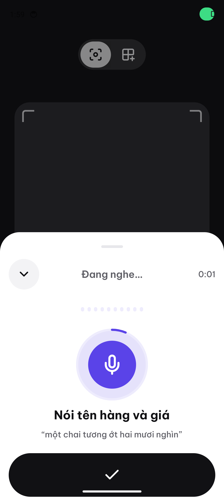
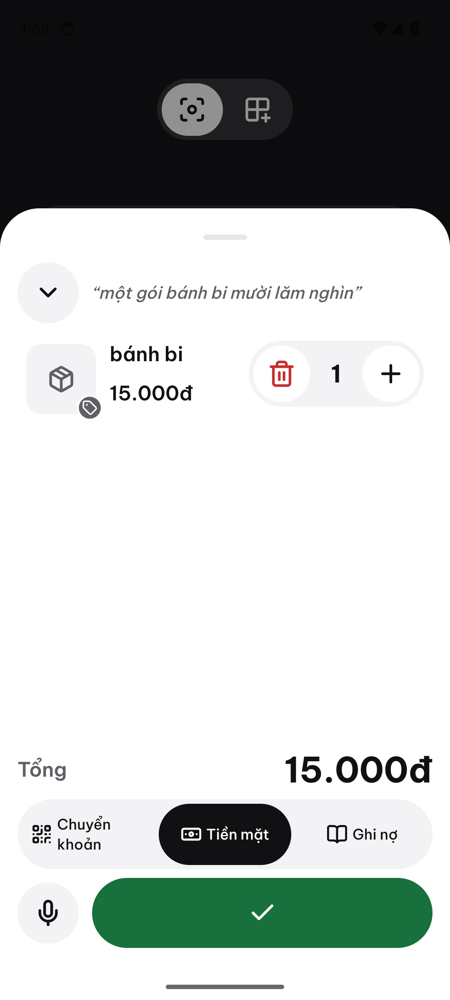
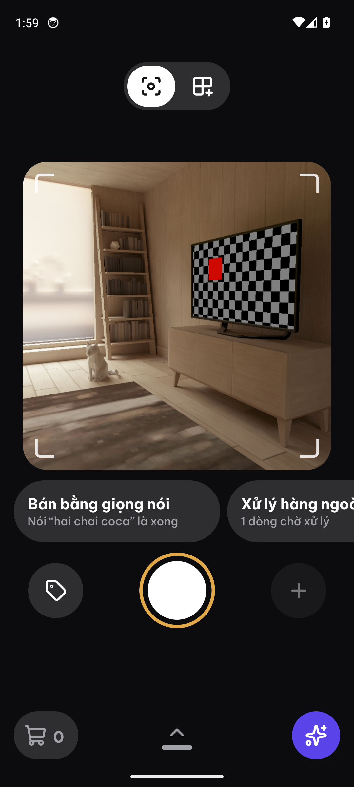
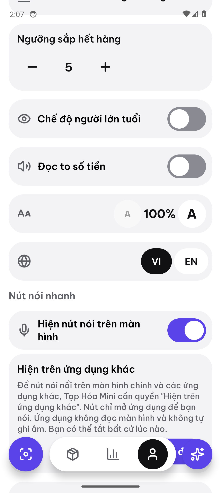
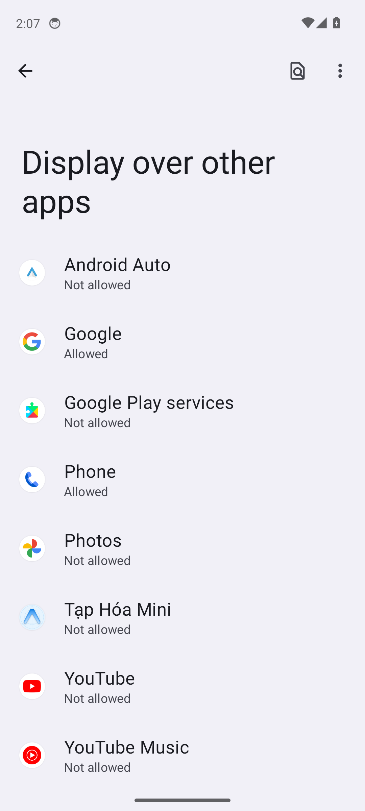

# Voice program: definition of done report

Program: [README](README.md) · Tracker: #69 · Date: 2026-10-29

This report checks each row of the README "Definition of done" against evidence in the repo, in
CI and in PostHog. Row 8 (iOS) is out of scope: there is no iOS build, and V4 (#74) stays open.

| #   | Row                                | State                                 | Proven by                                                                 |
| --- | ---------------------------------- | ------------------------------------- | ------------------------------------------------------------------------- |
| 1   | Android bubble, tile and shortcut  | Done in CI; real-device check pending | Kotlin unit tests, Jest, Maestro `voice-bubble.yaml` (PR #117)            |
| 2   | Voice sale draft, p95 under 3 s    | Done                                  | `tests/voice.rs`, e2e `voice.test.ts` (p95 2651 ms), Maestro `voice.yaml` |
| 3   | Unknown and ambiguous lines        | Done                                  | `tests/voice.rs`, Jest, golden set                                        |
| 4   | Chat microphone uses server speech | Done on Android                       | Jest `useServerVoiceInput.test.tsx`, `tests/voice.rs`                     |
| 5   | Golden set accuracy                | Done                                  | 52 clips: line 98.5 %, price 98.5 %                                       |
| 6   | Cost and daily cap                 | Done                                  | $0.00133 per utterance; 429 `voice_quota`; PostHog Voice dashboard        |
| 7   | Privacy, no AccessibilityService   | Done; Play forms pending              | No audio column, 30-day retention, plugin test, in-app explainer          |
| 8   | iOS entry points                   | Out of scope                          | No iOS build; V4 #74                                                      |
| 9   | Telemetry contract, CI, merged PRs | Done                                  | Contract tests, `ci-ok` on every epic PR, merged PRs below                |

## Screenshots

Maestro screenshots from Android E2E run 40801118589 (real APK, CI emulator):

| Voice sale: listening                                    | Draft                                            | Sold, line pending                             |
| -------------------------------------------------------- | ------------------------------------------------ | ---------------------------------------------- |
|  |  |  |

| Bubble explainer                                                | System "Display over other apps"                              |
| --------------------------------------------------------------- | ------------------------------------------------------------- |
|  |  |

## 1. Android entry points

- The local Expo module `apps/mobile/modules/voice-bubble` adds the overlay bubble (a foreground
  service of type `specialUse`), the Quick Settings tile, the static shortcut and the boot
  receiver. They only start the `/voice` route; recording happens in the app.
- Kotlin unit tests (`VoiceBubbleLogicTest.kt`) cover the deep link and return-to-previous app,
  edge snapping, clamping, the drag slop, hiding while the app is in front, long-press hide and
  the persisted on/off flag.
- Jest covers the config plugin (`withVoiceBubble.test.ts`) and the Account toggles
  (`VoiceSetupSection.test.tsx`).
- Maestro `voice-bubble.yaml` (android-e2e shard b) turns the bubble on in Tài khoản: the
  explainer appears first, "Để sau" leaves it off, and "Tiếp tục" opens the system "Hiện trên
  ứng dụng khác" screen.
- **Still open:** the owner's check on a real phone, with a screen recording, using the script in
  [play-console.md](play-console.md). An emulator cannot grant the overlay permission in CI or
  prove the 500 ms launch budget over other apps.

## 2. Voice sale

- Rust integration tests in `apps/backend/crates/api/tests/voice.rs` cover a two-line sale with
  prices, a credit sale, stock movement on Confirm
  (`voice_sale_lines_are_accepted_move_stock_and_count_in_the_event`), the model fallback chain,
  the deadline and the speech gate.
- The e2e suite `packages/e2e/tests/voice.test.ts` ran against Railway `test` with the real
  model (run 40754051457): 82 tests passed. The release-to-draft p95 was 2651 ms over 20 samples;
  the budget is 3000 ms.
- Maestro `voice.yaml` takes a real APK and the real backend from a fixture clip through the draft
  to Confirm. `POST /v1/sales` returns 201 and the unknown line reaches the pending chip (Android
  E2E run 40794313523). Playwright `voice.spec.ts` covers the same path on the web.

## 3. Unknown and ambiguous lines

- `unknown_product_becomes_a_manual_line_and_missing_price_needs_one` and
  `ambiguous_lines_carry_up_to_three_candidates` in `tests/voice.rs`.
- Nothing is written before Confirm. The draft endpoint stores only the utterance row; the sale is
  created by `POST /v1/sales` from the confirmed draft.
- Jest `VoiceSaleScreen.test.tsx` covers the candidate picker and manual lines.

## 4. Chat microphone

- The assistant composer uploads the clip in transcribe mode with the chat entry, and the backend
  returns the transcript without a draft
  (`chat_intent_and_transcribe_mode_return_the_transcript_without_a_draft`). The words fill the
  composer and are never sent by themselves.
- Offline, or on a 503 `voice_unavailable`, the composer falls back to on-device recognition. The
  daily quota is a plain failure, not a fallback (`useServerVoiceInput.test.tsx`).
- The web has no m4a recorder, so the server microphone is Android-only there. iOS shares the
  JavaScript path but has no build to check (row 8).

## 5. Golden set

- `packages/eval/golden/voice/` holds 52 synthetic Vietnamese clips (two TTS voices, with noise and
  silence cases).
- `pnpm --filter @taphoa/eval run voice` on the default model `google/gemini-3.1-flash-lite` scored
  98.5 % line accuracy and 98.5 % price accuracy, and silence answers `no_speech`. The rounds are
  in `packages/eval/results/voice-model-choice.md`; the eval workflow has a voice job.
- Clips recorded by real speakers would strengthen the set; the owner can add them later.

## 6. Cost

- The eval run cost $0.00133 per utterance on the default model; the budget is $0.002.
- `VOICE_DAILY_UTTERANCES_PER_STORE` caps utterances per store per day. Beyond it the API answers
  429 `voice_quota` (`daily_quota_answers_429_voice_quota`); server faults refund the unit.
- The PostHog [Voice dashboard](https://us.posthog.com/project/682994/dashboard/2273121) is managed
  in `infra/posthog/llm/voice.mjs`. On `test` over 7 days, 7 of 8 charts have data: cost per
  utterance, spend, the funnel, engine split, latency, STT fallback rate and calls by model.
  "Abandoned by stage" stays empty because no e2e run abandons a sale.

## 7. Privacy

- Audio is discarded after the model call unless the member turned on "Góp giọng nói để cải thiện" (off by default): the app then sends `donate=true` with a sale clip and the server keeps it in the private bucket under `voice/<store>/<uuid>.m4a`, marks the row `donated` (#163). `voice_utterances` (migration `1101_voice.sql`) keeps the transcript and
  the draft, not the clip. The `voice_retention` job deletes rows older than 30 days unless the
  member donated them.
- The app explains "Hiện trên ứng dụng khác" before it opens the system permission screen
  (`quickAccess.ts`, Maestro `voice-bubble.yaml`).
- The config plugin declares no AccessibilityService; a test fails if
  `BIND_ACCESSIBILITY_SERVICE` ever appears (`withVoiceBubble.test.ts`).
- **Still open:** the Play Console data-safety form and the foreground-service declaration. The
  texts are drafted in [play-console.md](play-console.md) for the owner to submit.

## 9. Telemetry, CI and merged PRs

- The new events (`voice_sale_started`, `voice_sale_drafted`, `voice_sale_confirmed`,
  `voice_sale_abandoned`, `voice_input_used`) and the voice `$ai_generation` properties are in the
  [telemetry contract](../assistant/telemetry-contract.md). `voice_telemetry.rs` and the mobile
  analytics tests check them.
- Assistant LLM charts exclude voice generations (`properties.voice_call IS NULL`).
- Merged PRs: #103 (V0), #101 (V6), #111 (V1), #122 (V5), #116 (V2), #117 (V3) and the #93 PR.
- Worktrees are cleaned per `AGENTS.md` after the last merge.
